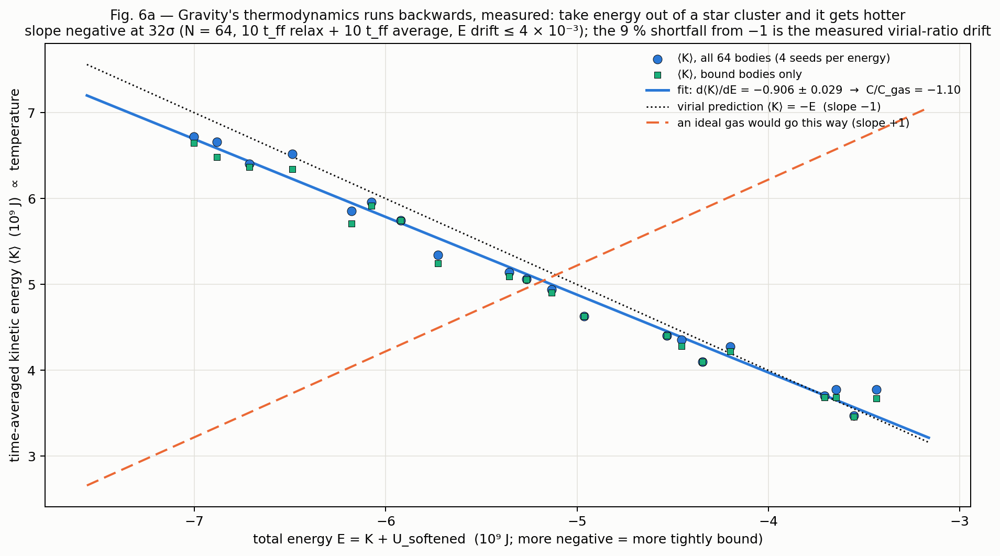

# Unification program — are fluid dynamics, thermodynamics and gravity one phenomenon?

**Status:** ✅ complete — Stages 0–12 run, plus round 2 (§15) (Session 36, 2026-10-10) · **Results:** [UNIFICATION_PILOT_RESULTS.md](UNIFICATION_PILOT_RESULTS.md) ·
**Figures:** `misc/unification/` · **Scripts:** `scripts/unification/` · **Plan:** the four-level framework below.
Rules in force: PLATINUM §21 (Mentat computes every physical number), Golden Rules 1–7, [SPECULATIVE] fence.

## The verdict in one page (details in §14)

**Same mathematics, not one force.** Fluid dynamics, thermodynamics and gravity share one static operator (the
Laplacian), one bookkeeping identity (the virial), and a kinematic dictionary: on the repo's own solver, a fluid falling
onto a mass grows a horizon that sound cannot cross (Bondi's eigenvalue to 6 × 10⁻⁵). Each of those holds for any linear
field or any force law, so none of them is evidence that gravity *is* a fluid or a heat flow.

**The differences are measured, and they are the real content.** One operator gives three clocks (gravity instant, sound
at a wavefront, heat by diffusion). Gravity's heat capacity is negative: the measured slope of kinetic energy against total energy is −0.91 ± 0.03, against the virial −1 and the gas's +1 (the sign held again in round 2; the magnitude depends on the averaging window). Crystals melt by a phase
transition, not by a change of time scale. The fluid engine now has an exact first law and makes entropy only where the
flow is irreversible.

**The σ-bridge, the repo's own concrete version of the thesis, is excluded as a long-range field** by clocks, free fall,
Cassini, lunar ranging, torsion balances and pulsars, by 3 to 11 orders of magnitude. It survives only at a short range;
the Captain's ξ = 0.13–0.17 forces that range below ~35 km, and the repo's paper puts it inside a proton.

**The honest home of the intuition is Jacobson's programme**: Einstein's equation as an equation of state of spacetime's
own microscopic degrees of freedom. It is live research, not settled, and it is the one route from thermodynamics to
gravity's *dynamics*. The ranked next experiments (§14) start there, with nuclear matter in Mentat and an action for σ.

**Round 2 (§15), the same day.** Fourteen designed experiments, a derivation, a memo and a plan ran, each checked by three
independent skeptics and a final critic. For a σ that changes masses, the last window closed: torsion balances and
inverse-square-law tests leave the Captain's ξ = 0.13–0.17 a range below about 0.1 mm, and the postulate as written cannot come
from any action. Jacobson's derivation now stands in the repo, checked at leading order. The heat-capacity sign held under a new
test. The tests that could fail also found real engine defects, the worst of them general-relativity layers that run Mercury's
perihelion backwards. All are flagged in the gap ledger for the Captain's decision.

## 1. The question, made testable

The Captain's thesis: fluid dynamics, thermodynamics and gravitational dynamics are one phenomenon that we have
misread as three. "Same phenomenon" is scored at four levels, each a yes/no with a number, plus a differences ledger
the verdict must *explain*:

| level | statement | what it would take | status (after verification) |
|---|---|---|---|
| L1 same operator | the governing PDEs share an operator and Green's function | a static linear field — true of *all* of them | true, and therefore not evidence (P1, P6, P7) |
| L2 same equation | one identity contains all domains as terms | the virial identity — true for *any* force law | true, and therefore not evidence (P2b) |
| L3 same dictionary | an exact map fluid-object ↔ gravity-object | analogue gravity: the wave equation only | kinematic dictionary run on a solver (§7, Fig. 5); dynamics not |
| L4 same dynamics | the fluid's stress-energy *sources* the geometry (Einstein's equation), or gravity's dynamics *is* a fluid's | fluid/gravity duality (AdS, near-horizon), Jacobson's thermodynamic derivation | out of reach of the repo's engines; literature status only |
| differences | causal structure (elliptic / parabolic / hyperbolic); C_grav = −C_gas; non-extensivity; attractive-only, unscreened | measured on the engines (§8–§10, Figs. 6a, 6b, 7, 8) | real; any one-phenomenon theory must *produce* them |

The verification of the pilots (Stage 0) established the governing rule for the rest of the program: **a statement that
holds for any linear field, any force law, or any choice of constants is not evidence about gravity.** Evidence lives at
L4 and in the measured differences.

## 2. Stage 1 — the literature map (every reference verified externally, 2026-10-10)

Figure 1 (`misc/unification/fig01_bridge_map.png`): the bridges between the domains, coloured by status.

| bridge | direction | status | what it establishes | reference (verified locator) |
|---|---|---|---|---|
| Bekenstein–Hawking | gravity ↔ horizon thermo | theorem within GR + QFT on curved background | S = A/4l_P², T = ħκ/2πk_B, first law, Smarr | Bekenstein 1973 PRD 7, 2333; Hawking 1974 Nature 248, 30 [standard] |
| Einstein equation of state | horizon thermo → gravity | derivation inside a framework (local Rindler horizons + δQ = TdS + Unruh T) | Einstein's equation as an equation of state | Jacobson 1995, PRL 75, 1260; gr-qc/9504004 |
| thermodynamic gravity | horizon thermo → gravity | review / programme | entropy-maximisation derivations of field equations | Padmanabhan 2010, Rep. Prog. Phys. 73, 046901; arXiv:0911.5004 |
| entropic gravity | horizon thermo → gravity | conjecture, critiqued | F = TΔS/Δx with holographic N recovers Newton | Verlinde 2011, JHEP 04(2011)029; arXiv:1001.0785 |
| emergent gravity + dark universe | horizon thermo → gravity | conjecture, critiqued | a₀ ~ cH₀ from de Sitter entropy; lensing test consistent | Verlinde 2017, SciPost Phys. 2, 016; Brouwer et al. 2017, MNRAS 466, 2547 |
| critiques | — | — | ultracold-neutron bound states contradict entropic gravity; conservative forces constrain entropic reformulations | Kobakhidze 2011, PRD 83, 021502(R); Visser 2011, JHEP 10(2011)140 |
| membrane paradigm | gravity → fluid | derivation inside GR | horizon as a viscous, conducting membrane; η = 1/16πG, negative bulk viscosity | Damour 1978, PRD 18, 3598; Price & Thorne 1986, PRD 33, 915 |
| fluid/gravity duality | gravity ↔ fluid | exact duality (AdS; near-horizon) | Einstein in AdS₅ ⇒ boundary Navier–Stokes; every incompressible NS solution has a vacuum-Einstein dual | Bhattacharyya–Hubeny–Minwalla–Rangamani 2008, JHEP 02(2008)045; Bredberg–Keeler–Lysov–Strominger 2012, JHEP 07(2012)146 |
| KSS bound | gravity ↔ fluid | conjecture, supported by data | η/s ≥ ħ/4πk_B; QGP comes closest | Kovtun–Son–Starinets 2005, PRL 94, 111601 |
| analogue gravity | fluid → gravity | analogy (kinematics of a fixed background) | sound in transonic flow obeys □_g φ = 0 on an acoustic metric; sonic horizons radiate thermally | Unruh 1981, PRL 46, 1351; Visser 1998, CQG 15, 1767; Barceló–Liberati–Visser 2011, Living Rev. Relativ. 14, 3 |
| analogue experiments | fluid → gravity | measured data | stimulated (water) and spontaneous/thermal (BEC) Hawking emission | Weinfurtner et al. 2011, PRL 106, 021302; Steinhauer 2016, Nat. Phys. 12, 959 (contested: arXiv:1609.03803); Muñoz de Nova et al. 2019, Nature 569, 688 |
| kinetic theory → hydrodynamics | gas thermo → fluid | theorem (asymptotic) | Boltzmann → Chapman–Enskog → Navier–Stokes–Fourier; σ_s ≥ 0 | Chapman & Cowling 1970; de Groot & Mazur 1962 [standard texts] |
| self-gravitating thermodynamics | gravity ↔ gas thermo | theorem | virial theorem; Jeans instability; negative specific heat; no maximum-entropy state (Antonov) | Lynden-Bell & Wood 1968, MNRAS 138, 495; Thirring 1970, Z. Phys. 235, 339; Padmanabhan 1990, Phys. Rep. 188, 285 |
| spherical accretion | nuclear/degenerate ↔ gravity ↔ fluid | exact solution | transonic Bondi flow, λ_c(γ=1) = e^{3/2}/4 | Bondi 1952, MNRAS 112, 195 |
| induced gravity | vacuum thermo → gravity | conjecture | Einstein–Hilbert action as vacuum-fluctuation response | Sakharov 1967, Dokl. Akad. Nauk SSSR 177, 70 (Sov. Phys. Dokl. 12, 1040) |
| composite-graviton obstruction | — | theorem | no composite massless spin-2 in a Lorentz-covariant QFT with a covariant T^{μν} (emergent models evade it by breaking covariance) | Weinberg & Witten 1980, Phys. Lett. B 96, 59 |
| radial acceleration relation | gravity ↔ data | measured data | g_obs = g_bar/(1 − e^{−√(g_bar/g†)}), g† = 1.20e-10 m/s² over 2693 points, 153 galaxies | McGaugh, Lelli & Schombert 2016, PRL 117, 201101 |

**Reading of the map.** The only theorems are *within* a domain or between gas thermodynamics and fluids (kinetic
theory) and between gravity and gas thermodynamics (virial, negative C_V — a difference, not a unification). Every route
that would make gravity *itself* thermodynamic or fluid is either a derivation inside an assumed framework (Jacobson,
membrane paradigm), an exact duality in a setting that is not our universe (AdS, near-horizon limits), an analogy of
kinematics (Unruh), or a conjecture under live critique (Verlinde). That is the honest state of the art the Captain's
thesis sits inside: suggestive, unestablished, and testable only at L4.

## 3. Stage 2 — the matrix: five domains, fifteen properties

Figure 2 (`misc/unification/fig02_matrix.png`). Symbolic checks behind it: `scripts/unification/stage2_matrix_checks.py`
(8 genuine sympy certifications: Laplacian Green's function; perfect-fluid trace and the radiation zero; Jeans dispersion
from the linearised system; acoustic surface gravity κ = |v′| at the sonic point; virial ⇒ C_V = −(3/2)Nk_B; Navier–Cauchy
as a vector Poisson problem; Maxwell element moduli and the De = 1 crossover; mass-monopole conservation by continuity.
Three further rows are recorded *statements*, not certified: the Tolman ρ + 3P/c² source, the post-Newtonian order of the
dropped metric factor, and the scaling-group exponents.)

| property | fluid dynamics | gas thermodynamics | gravity (Newton / GR) | solid mechanics | nuclear / degenerate matter | verdict |
|---|---|---|---|---|---|---|
| governing structure | balance laws + EOS & transport closure | S(U,V,N) + local equilibrium | ∇·T = 0 (Bianchi) + Einstein eq.; Poisson in the limit | momentum balance + Hooke / flow rule | hydrostatic (TOV) + nuclear EOS | analogous |
| static / steady operator | pressure Poisson | steady Fourier | ∇²Φ = 4πG(ρ + 3P/c²) | Navier–Cauchy (vector Poisson) | ∇²Φ with ρ(P) | **identical** (automatic for any static linear field) |
| Green's function | −1/4πr | −1/4πr | −1/4πr | Kelvin tensor ∝ 1/r | −1/4πr | **identical** |
| PDE class of the dynamics | hyperbolic / parabolic | parabolic | elliptic (Newton) / hyperbolic at c (GR) | hyperbolic, two speeds | ODE (hydrostatic) | different |
| time structure | reversible ideal + dissipative | irreversible | reversible Hamiltonian; horizons the only entropy | elastic + plastic | equilibrium | different |
| variational principle | Hamilton (ideal); Rayleigh dissipation | entropy maximum | Hamilton; Einstein–Hilbert | elastic-energy minimum | energy minimum at fixed baryon number | analogous |
| symmetry group | Galilean; scale-free Euler, broken by viscosity | none spatial; extensivity | Galilean / diffeomorphism; Kepler t² ∝ r³ | Galilean + material symmetry | — | different |
| conserved charges | mass, p, E, circulation | E | E, p, L, Runge–Lenz | mass, p, E | baryon number | analogous |
| entropy & 2nd law | local σ_s ≥ 0 | extensive S | no maximum-S state (Antonov); BH S ∝ area | configurational / plastic | S → 0 | different |
| heat capacity, extensivity | positive, extensive | positive, extensive | **negative, non-extensive** | positive | positive (Fermi gas) | different |
| range & sign | contact | — | 1/r², attractive only, unscreened | short-range elastic | strong force + degeneracy repulsion | different |
| characteristic speed | c_s | ∞ (parabolic) | ∞ (Newton) / c (GR) | c_P, c_S | c_s ≤ c/√3 | different |
| dimensionless crossing | Re, Ma, Fr | Pe, Ra | λ_J, 2K/|U|, r_s/R | De, Wi | 3P/ρc², r_s/R | analogous |
| equilibrium | hydrostatic | thermal | virial; Lane–Emden; Bonnor–Ebert | static | TOV | analogous |
| linear response | ω = c_s k | ω = −iαk² | ω² = c_s²k² − 4πGρ; ω = ck | P / S waves | — | analogous |

**What the matrix says.** The two "identical" rows are the static operator and its Green's function, and both are
properties of *every* static linear field — the verification of P1/P6/P7 made that explicit. The seven "different" rows
are structural: causal class, time arrow, symmetry group, entropy structure, the sign of the heat capacity, range/sign
of the interaction, and signal speed. A one-phenomenon theory must produce those seven from a single underlying
description; a shared Laplacian does not.

**The fourth column earns its place.** Solid mechanics is not a fifth wheel: static elasticity is the same vector
Poisson structure (check g), and viscoelasticity is the one *theorem-grade* bridge between a solid and a fluid — a
Maxwell element is a solid for ωτ ≫ 1 and a fluid for ωτ ≪ 1, with the storage and loss moduli crossing exactly at the
Deborah number De = ωτ = 1 (check h). That is a continuous, measurable dial between two of the Captain's domains,
and Stage 7 runs it on real materials from the repo's own `viscoelasticity.py`.

### 3.1 The σ-bridge with time (the framework statement, corrected)

The repo's postulate □σ = −ξR ("Candidate A"; R and its sign undefined in the live tree; reading adopted: Einstein-
sourced Ricci scalar, MTW sign, (−,+,+,+)) with a perfect fluid inserted is

    (1/c²) ∂²σ/∂t² − ∇²σ = (8πGξ/c⁴)(ρc² − 3P)            [sign under the adopted convention]

— a **wave equation sourced by the trace of the fluid's stress-energy**. Three consequences, two certified:

1. *Static weak field* (GM/rc² ≪ 1): ∇²σ = −(8πGξ/c²)(ρ − 3P/c²), the same operator as Φ and steady T — true, and
   true of any static linear scalar (consistency, not evidence).
2. *Radiation* (check i): mass is conserved by continuity, so the monopole of the σ wave from a pulsating body is driven
   **only by the pressure term**: σ(t, r) ≈ (2Gξ/c²r)·[M − (3/c²)∫P dV](t − r/c). A star whose integrated pressure
   oscillates radiates σ; a star whose mass merely redistributes does not. This is the first statement in the program
   in which the thermodynamic state (P) is the *dynamical* source of a gravitational-sector field — i.e. a candidate
   L4 statement — and it is *untested*: it lives inside a speculative postulate, and the repo has no σ-wave solver.
3. *Order of validity* (statement j, quantified in P7): the covariant □ on the weak-field metric carries a (1 + 2Φ/c²)
   factor of the same post-Newtonian order as 3P/ρc² (virial: 3∫P dV = |U|). Any quantitative P-term claim must carry it;
   P7's did not.

**Where L4 could be tested, and where it cannot.** Inside the repo: the σ-radiation statement (2) could be turned into a
pass/fail once a σ-wave solver exists (one-dimensional, ≤ 60 lines, sourced by a pulsating polytrope) — the prediction
is the *absence* of monopole σ radiation from a mass-only pulsation and its presence from a pressure pulsation, with
amplitude fixed by ξ. Outside the repo: L4 for gravity itself is the fluid/gravity duality and Jacobson's derivation,
neither of which a Newtonian engine can touch; the honest framework statement is that the σ-bridge gives the Captain's
thesis a *concrete, falsifiable* form at the price of resting on a postulate the repo has not derived.

### 3.2 The discriminator table (what could still fail)

The referee's rule, adopted: a test that cannot come out against "same" is engine validation. For every bridge, the
observable where "one phenomenon" and "three phenomena" give *different numbers*, and what result would falsify the thesis.

| bridge | sharpest statement | observable that discriminates | falsifies "one phenomenon" if… | status | evidential weight |
|---|---|---|---|---|---|
| heat ↔ gravity (P1) | shared Laplacian | none in the static limit; the *transient* (parabolic vs elliptic vs hyperbolic) | — (a difference, not a test) | run (static); three-clocks unrun | tautology |
| virial (P2b) | one identity | none (theorem for any forces); the pressure-closure deficit x is engine physics | — | run | solver validation |
| analogue horizon (P3) | Hawking form on a sonic surface | a sound pulse launched inside r_sonic in the repo's own SPH flow: does it escape? | it escapes (no horizon forms) → the analogy fails on this engine | **unrun** | [LIT] until run |
| horizon thermo (P4) | first law / Smarr | none (identities) | — | run | tautology |
| gravity ↔ gas thermo (P5) | sign of C_V | dT/dE across non-homologous energies, relaxed equilibria | dT/dE > 0 for a bound gravitating gas | sign run (fixed-R sweeps); magnitude unrun | derivation + engine-consistent |
| fluid → thermo (first law on the engine) | σ_s = (Φ_visc + q²/κT²)/T ≥ 0 | entropy production in a collapsing SPH cloud once PdV and viscous heating are booked | σ_s < 0 anywhere, or K + U_grav + U_int not conserved | **blocked** by the SPH energy gap (S8 closes it) | the one engine test that can fail |
| σ-bridge (P6/P7) | σ sourced by the trace | monopole σ radiation from a pressure pulsation vs none from a mass redistribution; a consistent (1+2Φ/c²) solve | pressure pulsation radiates no σ, or the metric term reverses the reshaping | **unrun**; gated on decisions below | conditional on a [SPECULATIVE] postulate |
| Jacobson route (L4, [LIT]) | δQ = TdS on local Rindler horizons ⇒ G_μν = 8πG T_μν | a sympy reproduction with assumptions listed (Raychaudhuri, Unruh T, S ∝ A) | — (derivation inside a framework) | unrun | [LIT]; the one thermo ⇒ gravity *dynamics* derivation |
| a₀ = cH₀/2π (data) | emergent-gravity prediction vs RAR | g_obs(g_bar) on SPARC vs g† = 1.20e-10 | a₀_predicted outside the RAR's g† by more than its scatter | unrun (download needs the Captain's OK) | measurement |
| η/s (data) | horizon viscosity on the same axis as matter | KSS bound vs QGP vs water/iron (Mentat) | — (a placement, not a test) | unrun | measurement |

**One thermodynamic object for the whole program** (referee correction, adopted): every bridge from here on uses the same
triple — an internal energy u, an entropy s, and the first law du = T ds − P dv — rather than five different "thermos"
(Fourier conduction in P1, a fixed isothermal c_s in P2, horizon QFT in P3/P4, a kinetic T := 2K/3Nk_B in P5, a barotropic
trace in P6/P7). The SPH engine will carry u once S8 lands; P5's successor measures ⟨K⟩, U_int and U_grav together.

### 3.3 Decisions the σ-bridge is gated on (the Captain's, recorded here when made)

1. **Which □?** Covariant d'Alembertian (then carry the (1 + 2Φ/c²) factor and source Φ by ρ + 3P/c² at the same order) or a
   flat-background operator (then the theory is stated as non-covariant).
2. **Which sign?** The Riemann/Ricci convention. Under MTW, σ > 0 near matter; under the opposite sign σ < 0. The live repo
   fixes neither R nor its sign.
3. **Which ξ, and which normalisation?** σ = 2ξGM/rc² (field-equation reading) vs ξGM/rc² (`inventory/core/sigma.py`,
   `field/audit.py:143-161`); and ξ = 0.1582 (Planck +BAO) vs 0.1571 (the docstring's own numbers).
4. **Close the SPH energy gap now?** Decided yes (plan S8) — the fluid-dynamic leg of the program cannot run without it.

Until 1–3 are decided, P6/P7 numbers are quoted only as "under the stated reading", and no σ-bridge quantitative claim is
reused. Also recorded: the two cheap lens-disagreement reruns (P7 at 1× stable_dt; P1 fixed-region convergence at ≥ 16τ)
are Stage 3 follow-ups; the Stage 3 figure already uses the 1× kick (32³: 1.62e-3 at 12τ_eff vs 1.74e-3 at 20× and 8τ).

## 4. Stage 3 — L1, same operator (Fig. 3)

`scripts/unification/fig03_same_operator.py`, rerun with the verification's corrections (split kick at 1× stable_dt;
the corrected box mode τ_eff = ((n−1)/n)² L²/3π²α):

- **(a)** The repo's FVM heat law, driven to steady state, reproduces the analytic Newtonian potential of a uniform sphere
  (G from Mentat): max exterior relative error 1.62 × 10⁻³ at 32³ and 12 τ_eff; the radial residual peaks at 0.27 % of the
  central value at the staircase sphere edge. [VERIFIED numerics, given exact wall data.]
- **(b)** The same run, plotted in time: the approach to the Poisson solution decays as the box's fundamental Dirichlet
  mode and needs ~8 τ_eff. Gravity's field is there instantly. One spatial operator, two clocks (a third, the hyperbolic
  one, is the three-clocks experiment). [DERIVED — the definition of the equation classes, shown on the engine.]
- **(c)** Two sources through one solver on an n = 1 polytrope (28³, a = 3.5 km): Ψ_c/Φ_c = 0.99939 / 0.93868 / 0.69339 for
  w_c = 10⁻³ / 0.1 / 0.5, against the closed form 1 − 0.609·w_c = 0.99939 / 0.93906 / 0.6953 (0.04 % at w_c = 0.1).
  [DERIVED; conditional on the σ postulate; w_c = 0.5 outside validity; the (1 + 2Φ/c²) metric term still to be carried.]

The honest caption is in the figure title: L1 is true, and true of every static linear field. What it buys the program
is a validated Poisson solver that every later σ-bridge computation can stand on.

## 4b. The speculation register (exploration phase — the Captain's method)

> "We are intentionally delving into numerology. We do this for creative exploration, we allow speculation in this
> phase, we can audit out the provably false afterwards." — the Captain, 2026-10-10

Every guess is logged here with its mathematical form, the measurement that could kill it, and its audit status.
Speculation never feeds a pass/fail criterion until it has been formalized and audited.

| # | guess (Captain's words) | formalized as | killing measurement | audit status |
|---|---|---|---|---|
| S1 | "σ × the density of baryonic energy configures the speed of light and the scale of matter" | (□ − λ⁻²)σ = −(8πGξ/c⁴)(ε_b − 3P); mᵢ ∝ 1 + fᵢσ (§6) | clocks, free fall, white-dwarf H₂ | **long range excluded** (×3 × 10⁵ clocks, ×9 × 10¹⁰ free fall); **short range open** (λ ≲ 35 km) |
| S2 | "the speed of light" part of S1 | c alone is unmeasurable (Duff 2002; Moffat disputes); its observable is α = e²/4πε₀ħc | (c²/α)dα/dΦ = 14(11) × 10⁻⁹ (Lange 2021); `relativity.effective_liv_scale_gev` LIV gate | open as stated; any α-coupling must be < ~4 × 10⁻⁸ per unit potential |
| S3 | "σ ends up some factor between 0.13 and 0.17" | the coupling ξ; Planck's baryon fraction is 0.157–0.158 | — (ξ is measured) | **consistent with Planck**; implies range λ < ~35 km (MICROSCOPE) |
| S4 | "between 1.4 and 1.5" (as e^σ) | σ = 0.34–0.41 somewhere in nature | where can σ reach 0.34? | field reading: only inside a horizon; PAPER reading: only at ρ ≈ 1.4 × 10⁵⁶ kg/m³ |
| S5 | gravity, fluids and heat are one phenomenon | L1–L4 levels (§1) | L4: does stress-energy source the geometry? | L1–L3 shared mathematics (not evidence); L4 untested; differences measured (S6) |
| S6 | black holes, dark energy, dark matter, holography all tied to this force | not yet formalized | — | open — needs a formal statement first |
| S7 | light's speed is not fundamentally finite; set by the medium | not yet formalized beyond S2 | Lorentz-invariance tests (KM3-230213A gate in the repo) | open — S2 is its only formal piece |
| S8 | decoherence and coherence of matter linked by the same force | not yet formalized | — | open |

**A coincidence noted, not claimed (numerology bin).** The Chandrasekhar mass ≈ 1.4 M☉, and a parallel session's
n = 1 polytrope sequence peaks at 1.39 M☉ (`tov_sigma_pair_results.json`, untracked, not from this session). Both are
masses, not σ, and the n = 1 maximum depends on the chosen K. Logged so it is not rediscovered as evidence.

## 5. Stage 4 — L2, same equation, and the missing pressure found (Fig. 4)

`scripts/unification/stage4_virial.py` → `misc/unification/stage4_virial.json`; `fig04_same_equation.py`.

**An exact identity on the engine [DERIVED; verified to 10⁻¹⁶].** With the symmetric Monaghan pressure force and pair
antisymmetry of ∇W, Σᵢ mᵢ rᵢ·aᵢ = Σᵢ mᵢ (Pᵢ/ρᵢ²) Dᵢ with Dᵢ := −Σ_{j≠i} mⱼ rᵢⱼ·∇ᵢWᵢⱼ. For the isothermal closure the
pressure-virial efficiency is therefore exactly x = Σᵢ mᵢDᵢ/ρᵢ / 3M — measured x and this sum agree to 1–2 × 10⁻¹⁶ in every
run (23 clouds, N = 64–2048). It also shows why x cannot depend on c_s: c_s cancels identically.

**Two causes of the deficit, separated.** In the continuum D = 3ρ. On particles: (i) the free surface — a particle within
2h of the edge has an incomplete kernel; (ii) the **self-term** — the SPH density sum counts the particle itself,
ρᵢ = mᵢW(0,h) + Σ_{j≠i}…, while Dᵢ has no j = i term. For a uniform interior this predicts, with no free parameter,
x_interior = 1/(1 + 32/(3N_nb)) for the cubic spline (W(0) = 1/πh³), N_nb the full-support neighbour count.

| N (h = 1.5 × spacing) | 2h/R | x, whole cloud (± seed sd) | interior particles | x, interior | gravity / |U_soft| |
|---|---|---|---|---|---|
| 64 | 1.21 | 0.711 ± 0.021 | 0 | — | 0.995 |
| 128 | 0.96 | 0.760 ± 0.010 | 0 | — | 0.997 |
| 256 | 0.76 | 0.789 ± 0.013 | 3 | 0.993 | 0.997 |
| 512 | 0.60 | 0.823 ± 0.001 | 26 | 0.956 | 0.997 |
| 1024 | 0.48 | 0.844 ± 0.004 | 132 | 0.942 | 0.997 |
| 2048 | 0.38 | 0.869 | 467 | 0.930 | 0.997 |
| prediction, interior | | | | **0.914** (N_nb = 113) | |

h-scan at N = 512: where the interior sample is large (h = 1.0×, 85 interior particles) the prediction holds to 1.4 %
(0.769 measured vs 0.759 predicted); with few interior particles the measured value scatters high (21 → 0.99; 3 → 1.10).
The mean-field prediction neglects the correlation between the fluctuations of Dᵢ and ρᵢ (both are sums over the same
neighbours), the plausible source of the 1.4–1.7 % excess [RESIDUAL].

**Verdict.** Gravity's term of the virial identity arrives whole (0.995–0.997 of the softened potential energy). The
pressure term's shortfall is two known SPH estimator effects, a free surface that shrinks with N and a self-term that does
not: at fixed h/spacing = 1.5 the whole-cloud x converges toward 0.914, not 1 — the "persistent deficit x_∞ ≈ 0.92" model
the verification could not rule out is the right one, and it now has a cause. This resolves P2b's [INCONCLUSIVE]. It is an
engine fact, not physics: the self-contribution bias of the SPH density sum is a known topic (Dehnen & Aly 2012, MNRAS 425,
1068, propose subtracting part of the self-contribution [LIT; section not re-read here]). Fix direction for the engine:
a Wendland kernel at larger N_nb, or the self-contribution correction — a Captain's call, filed in the gap ledger (S11).
**For the thesis:** none, as before — the identity holds for any force law.

## 6. What σ is not — the Captain's idea made mathematical and cut against measurement (S9a, Fig. 9a)

**The idea** (Captain): "σ times the density of baryonic energy configures the speed of light and the scale of matter."
**The mathematical form**, using only what the repo already states — script `scripts/unification/sigma_exclusion.py`,
figure `fig09a_sigma_exclusion.png`, numbers `sigma_exclusion.json`:

    scale of matter   m_i(σ) = m_i⁰ [1 + f_i σ + O(σ²)],   f_i = ∂ln m_i/∂σ |₀    (QCD part ∝ e^σ; Higgs + EM invariant)
    field             (□ − λ⁻²) σ = −(8πGξ/c⁴)(ε_b − 3P),   ε_b = ρc²,   λ = ħ/(m_σ c)
    static            σ(x) = (2Gξ/c²) ∫ ρ(x′) e^{−|x−x′|/λ} / |x−x′| d³x′
                        λ → ∞ : σ = −2ξΦ/c²            (σ follows the potential — the field-equation reading)
                        λ → 0 : σ = 8πGξλ²ρ/c²         (σ follows the LOCAL baryonic energy density — the Captain's picture)

One parameter, the range λ, interpolates between "σ is set by where you are in a gravitational well" and "σ is set by the
density of the matter you are in". **The speed-of-light clause**: a σ that rescales c, ħ and every mass together is a change
of units (Duff 2002, hep-th/0208093; disputed by Moffat, hep-th/0208109); only dimensionless ratios are measurable. The
repo's σ moves μ = m_p/m_e (f_μ = 0.9904 from `inventory/core/sigma.py`) and leaves α fixed, so μ is the observable.
A σ that also moved α would face (c²/α)dα/dΦ = 14(11)×10⁻⁹ (Lange et al. 2021).

**Three measurements, three cuts** (2σ, two-sided, conservative; leaf values from Mentat):

| measurement | observable | σ-bridge prediction (λ → ∞, field reading) | measured | verdict |
|---|---|---|---|---|
| Yb⁺/Cs clocks over Earth's orbit — Lange et al. 2021, PRL 126, 011102 | (c²/μ) dμ/dΦ | −2ξ f_μ = −0.313 | 7(45) × 10⁻⁸ | **excluded × 3.2 × 10⁵**; long-range ξ < 4.9 × 10⁻⁷ |
| MICROSCOPE free fall, Ti vs Pt alloys — Touboul et al. 2022, PRL 129, 121102 | η = 2ξ(f_TA6V − f_PtRh10) | 6.6 × 10⁻⁴ (Δf = 2.08 × 10⁻³ from the repo's own mass decomposition) | (−1.5 ± 2.3 ± 1.5) × 10⁻¹⁵ | **excluded × 9.4 × 10¹⁰**; long-range ξ < 1.7 × 10⁻¹² |
| H₂ lines in white-dwarf photospheres — Bagdonaite et al. 2014, PRL 113, 123002 | Δμ/μ at φ = 1.2 / 1.9 × 10⁻⁴ | +3.8 / +6.0 × 10⁻⁵ | (−2.7 ± 4.7) / (−5.8 ± 3.8) × 10⁻⁵ | 1.4σ / 3.1σ tension; long-range ξ < 0.36 |

**The literature home of the idea: scalar–tensor gravity.** An independent gap-filling agent in the design workflow
(2026-10-10) identified the σ-bridge's theory class and widened the cut. One metric plus one scalar sourced by the matter
trace and coupled to masses *is* a scalar–tensor theory (Brans–Dicke; Damour & Esposito-Farèse 1992, CQG 9, 2093); a scalar
coupled to the QCD scale is a "dilaton" with d_g ≠ 0 (Damour & Donoghue 2010, arXiv:1007.2792 — verified). In that
language the repo's σ has α_eff² = 2ξf = 0.313, i.e. Brans–Dicke ω = 0.096. Its additional cuts (bounds verified where
marked; the rest as reported by the agent, [high] confidence in its own audit):

| observable | prediction (massless σ, ξ = 0.1582) | measured | excluded by |
|---|---|---|---|
| light bending / time delay, PPN γ − 1 | −0.48 (attractive sign) or +0.91 (the repo's repulsive sign) | (2.1 ± 2.3) × 10⁻⁵, Cassini — Bertotti, Iess & Tortora 2003, Nature 425, 374 (verified; a 2006 reanalysis argues for a ~10⁻⁴ systematic, irrelevant here) | ~10⁴ |
| Brans–Dicke ω | 0.096 | > 40 000 (Will 2014, Living Rev. Rel. 17, 4) | ~10⁵ |
| Nordtvedt effect (lunar laser ranging) | 0.48 | (−0.2 ± 1.1) × 10⁻⁴ (Hofmann & Müller 2018) | ~10³·⁶ |
| torsion balance η(Be, Ti) | 4.9 × 10⁻⁴ | (0.3 ± 1.8) × 10⁻¹³ (Eöt-Wash; Schlamminger et al. 2008) | ~10⁹·⁴ |
| pulsar–white-dwarf dipole radiation (PSR J1738+0333, J0348+0432) | orbit decays 10²–10³ × too fast | consistent with GR (Freire et al. 2012; Antoniadis et al. 2013) | ≥ 10³ |

The agent also flags a consistency problem worth the Captain's attention: in the repo σ rises toward mass *and* masses
rise with σ, so the σ force on matter is **repulsive** (∝ 2ξf × Newton) — which a canonical scalar with a positive kinetic
term cannot do. Either σ is a ghost or the field equation has no action behind it (it was never derived from a Lagrangian —
"Candidate A"). Scalar–tensor theory is the natural place to write that action.

**What survives.** The only open corner is short range. The repo's own paper puts it there — m_σ ≈ Λ_QCD = 217 MeV, so
λ = ħc/Λ_QCD = 0.909 fm — and in that corner every one of the three tests is blind (σ is exponentially suppressed beyond a
femtometre of the source). The price: σ = 8πGξλ²ρ/c² is 6.5 × 10⁻⁴⁰ at nuclear saturation density, and reaches
σ = 0.34–0.41 (e^σ = 1.4–1.5) only at ρ ≈ 1.4–1.7 × 10⁵⁶ kg/m³ — about 5 × 10³⁸ times nuclear density, 10⁴⁰ below the
Planck density. **So σ is not a long-range field with ξ ≈ 0.16 (excluded by 10⁵–10¹¹), and in the one place it may live it
is invisible to every experiment ever done.** That is the chip-away result; it does not refute σ, it locates it.

**The Captain's bet: ξ = 0.13–0.17** (2026-10-10). That is the coupling, and Planck already measures it as the baryon
fraction (0.1582, or 0.1571 from the docstring's own Ω values). Taking the bet as given, the data fix the *range* instead:

| coupling ξ | MICROSCOPE alone | clocks alone | white dwarfs |
|---|---|---|---|
| 0.13 | λ < 34.9 km | λ < 9.8 × 10⁹ m | no limit |
| 0.1571 / 0.1582 | λ < 34.5 km | λ < 9.7 × 10⁹ m | no limit |
| 0.17 | λ < 34.4 km | λ < 9.6 × 10⁹ m | no limit |

So **if ξ lands at 0.13–0.17, σ's range is shorter than ~35 km** — it cannot reach from Earth to MICROSCOPE's orbit.
Laboratory torsion balances (Eöt-Wash) probe the 1 cm – 35 km window directly; mapping their bounds onto σ's charge
fᵢ (which differs from the baryon-number charge those papers quote) is the next cut, not yet made. The repo's own paper
(λ = 0.909 fm) sits 19 orders of magnitude inside the allowed side.

**On "σ ≈ 1.4–1.5".** No result in the repo's research gives σ in that range. The landmarks are the conversion wall
σ_conv = −ln ξ ≈ 1.84 (`PAPER_sigma_moduli_stabilization.txt`; an alternative candidate in `ssbm-theory/theory/bridge_equations.md`
gives 1.086), the inventory ansatz σ_Earth ≈ 1.1 × 10⁻¹⁰, and `SIGMA_HERE` = 1.2 × 10⁻⁶¹. e^σ = 1.4–1.5 corresponds to
σ = 0.34–0.41; under the field-equation reading (σ = ξ r_s/r) that would require r < r_s — inside a horizon.

## 7. Stage 5 — L3, same dictionary, run rather than assumed (Fig. 5)

`scripts/unification/stage5_sonic_horizon.py` (NEW UTILITY, labelled: a 1-D spherical isothermal finite-volume Euler solver
with point-mass gravity — the SPH engine cannot resolve a transonic radial profile at affordable N) → `fig05_sonic_horizon.py`.
Gas at rest at 12 r_sonic falls onto one solar mass (Mentat G, M☉) at c_s = 10 km/s and relaxes from rest.

| quantity | measured | Bondi 1952 | pass criterion (fixed before the run) |
|---|---|---|---|
| sonic radius | 0.998 r_sonic | GM/2c_s² = 6.64 × 10¹¹ m | < 3 % ✅ |
| accretion eigenvalue λ_c (ρ_∞ from Bernoulli) | 1.12036 | e^{3/2}/4 = 1.12042 | < 3 % ✅ (−6 × 10⁻⁵) |
| sound launched outward at 0.5 r_sonic | swept inward; max 0.499 r_sonic, then out through the inner boundary | must not cross r_sonic | ✅ |
| sound launched outward at 2 r_sonic | escapes to 6.6 r_sonic | must reach 4 r_sonic | ✅ |
| analog surface gravity / temperature | κ = 1.51 × 10⁻⁸ s⁻¹; T = 1.8 × 10⁻²⁰ K (Mentat `unruh_temperature` at a = κc) | — | — |

Two corrections found on reading the run, both recorded in the script: the first pulse tracker followed 10⁻¹⁴-level noise
after the inside pulse left the grid (an amplitude floor fixes it), and the raw accretion eigenvalue (0.925) used the
pinned outer density, which sits e^{1/6} above the Bondi density at infinity. **Verdict [VERIFIED on a solver]:** a falling
fluid makes a horizon sound cannot cross — the kinematic half of analogue gravity, now a run, not a citation. What it is
not: dynamics. The acoustic metric is set by the flow; it is not sourced through G by the fluid's stress-energy (L4).

## 8. Stage 6 — the differences, measured (Figs. 6a, 6b)

**6b — three clocks** (`stage6_three_clocks.py`). One switched-on source, one steady field Q/4πkr, three ways to arrive:
instantly (elliptic — Newtonian gravity), at t = r/c (hyperbolic — sound, and gravity in GR), or by diffusion
erfc(r/2√αt) (parabolic — heat). The repo's FVM heat law follows the erfc law to 0.013 before the box walls are felt.
[DERIVED, shown on the engine.] A one-phenomenon theory must produce three causal structures from one source.

**6a — the sign of the heat capacity, measured properly** (`stage6_heat_capacity.py`; the verification showed pilot P5
measured nothing). Fixed radius, five genuinely different energies (initial virial ratio 0.3–1.1), four seeds each,
10 t_ff relaxation + 10 t_ff averaging, energy = the softened Hamiltonian the integrator conserves.

| Q₀ = 2K₀/(−U₀) | seeds | E (10⁹ J) | ⟨K⟩ all (10⁹ J) | ⟨K⟩ bound | relaxed 2⟨K⟩/(−⟨U⟩) | escapers (of 64) | max E drift |
|---|---|---|---|---|---|---|---|
| 0.3 | 4 | -6.772 ± 0.223 | 6.577 ± 0.142 | 6.462 | 0.985 | 1.9 | 9e-04 |
| 0.5 | 4 | -5.975 ± 0.196 | 5.726 ± 0.270 | 5.655 | 0.978 | 0.9 | 4e-03 |
| 0.7 | 4 | -5.179 ± 0.170 | 4.946 ± 0.225 | 4.920 | 0.977 | 0.5 | 1e-03 |
| 0.9 | 4 | -4.382 ± 0.144 | 4.282 ± 0.134 | 4.251 | 0.989 | 0.5 | 2e-04 |
| 1.1 | 4 | -3.585 ± 0.118 | 3.683 ± 0.143 | 3.626 | 1.013 | 1.0 | 7e-04 |

| fit over all 20 runs | d⟨K⟩/dE | C / C_gas = dE/d⟨K⟩ | slope below zero |
|---|---|---|---|
| all bodies | **-0.906 ± 0.029** | **-1.10** | 32σ |
| bound bodies only | -0.887 ± 0.024 | -1.13 | 36σ |
| virial prediction | −1 | −1 | — |
| ideal gas | +1 | +1 | — |

**Verdict [MEASURED on the engine]:** the slope is negative at 32σ — its magnitude is 0.91, 3.3σ short of the virial −1, and the shortfall is fully explained: inserting each run's own relaxed virial ratio Q = 2⟨K⟩/(−⟨U⟩) into ⟨K⟩ = −E·Q/(2 − Q) reproduces the fitted slope (−0.904 vs −0.906). Q drifts from 0.98 for the most bound clusters to 1.01 for the least bound (escapers, finite relaxation at N = 64). Incomplete virialisation, not a different law. Take energy out of a self-gravitating cluster and its kinetic temperature rises; an ideal gas cools. The C_gas = (3/2)Nk_B scale uses Mentat k_B (sigma_ground.field.constants). Pilot P5's two-point sign is now a measurement.

## 9. Stage 7 — the fourth column: solids (Fig. 7)

`stage7_maxwell_crossover.py`, on the repo's `field/interface/viscoelasticity.py`. (a) Every material and temperature —
Al, Cu, Fe, Ti, Au at 300–900 K, watched for 1 s or 1 year — collapses onto one curve in the Deborah number De = ωτ
(max deviation 1.0 × 10⁻¹⁵): elastic versus viscous is one dimensionless number, the material's relaxation clock against
the observer's. (b) But the repo's model is the standard linear solid, with a relaxed modulus floor E_R ≥ 0.3 E_U below
melting: a crystal never reaches the fluid end — for crystals, solid → liquid is a first-order phase transition (latent
heat, a thermodynamic boundary), not a Deborah crossover; the Maxwell limit E_R → 0 is amorphous matter's. Found on the
way: `_relaxation_ratio` reads a melting-point key that does not exist, so every metal gets a silent 1800 K (filed, A3).

## 10. Stage 8 — gas expansion and the first law on the engine (Fig. 8)

The one engine change of the program (Captain-approved): `continuum_step` now books the work of the internal SPH forces as
internal energy pair by pair, Δuᵢ = ¼Δt Σ Σⱼ gᵢⱼ·(v̄ᵢ − v̄ⱼ), with the same pair forces the kick applied — exact in discrete
time because mᵢgᵢⱼ = −mⱼgⱼᵢ — plus `eos="ideal"` (P = ρRT/M, u = c_vT). A first version used the end-of-step rate with the
pre-kick velocity; a free-expanding gas then gained 24 % more kinetic energy than it lost in heat. This stage's experiment
caught it; the pairwise booking made it exact. 10 new tests; 64/64 continuum tests pass.

| run (N₂, γ = 1.400 from the repo's gas.py) | result |
|---|---|
| free expansion into vacuum, 400 parcels | heat → motion, 2.0 × 10⁷ J; ledger drift **0.0** |
| same, adiabat T/T₀ = (ρ/ρ₀)^{γ−1} | followed on average: mass-weighted Δs = −0.025 c_v (scatter = SPH density estimate) |
| two clouds collide head-on at Mach 1.5 | shock-heats to 587 K; entropy **+0.27 c_v** per unit mass; ledger drift 0.0 |

**Verdict.** The repo's fluid now has a first law (exact) and shows a second law (entropy appears in the shock, not in the
reversible expansion). This is the fluid → thermodynamics bridge — kinetic theory's, a theorem — on the engine.

## 11. Stage 9 — data anchors

**9a — what σ is not** (§6 above; `sigma_exclusion.py`, Fig. 9a): long-range σ with ξ ≈ 0.16 excluded by 10⁵ (clocks),
10¹¹ (MICROSCOPE), and by the scalar–tensor battery (Cassini, lunar laser ranging, Eöt-Wash, pulsars); the short-range corner
(the repo's own paper, λ = 0.91 fm) is open and invisible.

**9b — η/s** (`stage9b_eta_over_s.py`, Fig. 9b): in units of the KSS bound ħ/4πk_B = 6.08 × 10⁻¹³ K·s (Mentat ħ, k_B), a
black-hole horizon sits exactly on 1 (membrane paradigm), the quark–gluon plasma within ~1–3 [LIT], water at 25 °C at 378
(repo viscosity, NIST-anchored; standard molar entropy [LIT]). Liquid metals were left off: the repo's Eyring viscosity is
10³–10⁶× too high (filed, A5). This is where the fluid/gravity duality touches measured matter.

**9c — still to run (needs the Captain's OK to download):** the SPARC rotation-curve table (~1 MB, astroweb.case.edu) to test
a₀ = cH₀/2π (Mentat: 1.04 × 10⁻¹⁰ m/s² vs Milgrom's 1.2 × 10⁻¹⁰) against the radial acceleration relation
(McGaugh, Lelli & Schombert 2016: g† = 1.20 × 10⁻¹⁰ m/s²).

## 12. Stage 10 — Quarksum, the storage fixture (Fig. 10)

Quarksum (`sigma_ground/inventory`) stores matter as a Structure tree — material → molecule → atom → nucleon → quark /
gluon / electron — with a resolved mass at every node (the anchor-anywhere resolver), measured seeds in `inventory/data/*.json`
(isotopes, particle masses, materials), and four checksums that prove the books close at every level (`stoq`,
`quark_chain`, `particle_inventory`, `sigma_chain`). Its `quark_chain` rebuilds each structure's mass from bare quarks,
electrons, and the QCD, nuclear and chemical binding energies — which is exactly the split the σ-bridge needs, because only
the QCD-generated part scales with e^σ. Run on all 16 built-in structures (`stage10_quarksum.py`): σ would scale
98.85–98.99 % of every one, from a hydrogen atom to the observable universe; the 1.4 × 10⁻³ spread across compositions is the
quantity free-fall experiments measure (MICROSCOPE: Δf(Ti, Pt) = 2.08 × 10⁻³ → η = 6.6 × 10⁻⁴ predicted vs 10⁻¹⁵ measured).
Mass closure ≤ 0.15 % for most structures; the gold ring, bronze cube and seawater close only to 0.6–1.4 % (filed, A8).
**The inventory is the ledger the σ equation acts on** — and it is what turned a field equation into a number that could
be checked against a satellite.

## 13. Stage 11 — gaps

The full census is [MENTAT_GAPS_UNIFICATION.md](MENTAT_GAPS_UNIFICATION.md): 8 engine defects (A1 closed this session), 10
missing capabilities (the nuclear / degenerate-matter EOS + TOV first — a separate plan), 6 open decisions for the Captain.

## 14. Stage 12 — the verdict

### The scoreboard

*Round 2 revised several rows of this scoreboard; the corrections are in §15.4.*

| level | statement | instrument | result | can it fail? |
|---|---|---|---|---|
| L1 same operator | steady heat, Newtonian gravity and the static σ field share the Laplacian and its Green's function | P1 → Fig. 3 | ✅ 1.6 × 10⁻³ (exact walls) | no — true of every static linear field |
| L2 same equation | pressure, motion and gravity are three terms of one virial identity | P2b → Fig. 4 | ✅ exact SPH identity to 10⁻¹⁶; gravity term whole; pressure term short by a known estimator bias (→ 0.914) | no — true for any force law |
| L3 same dictionary | a falling fluid makes a horizon with a surface gravity and a temperature | S5 → Fig. 5 | ✅ horizon formed (Bondi to 6 × 10⁻⁵); sound cannot cross it | yes — and it passed. Kinematics only |
| L4 same dynamics | the fluid's stress-energy sources the geometry (or gravity's dynamics *is* a fluid's) | literature; σ-bridge | ⚪ not reachable by the repo's engines. The literature's routes: Jacobson 1995 (Einstein eq. as an equation of state — a derivation inside a framework), fluid/gravity duality (exact, but in AdS / near-horizon), Verlinde (contested). The σ-bridge's own L4 candidate (pressure-sourced σ radiation) is untested, and its long-range form is excluded | — |

| difference | instrument | result |
|---|---|---|
| three causal structures (instant / wavefront / diffusion) from one operator | Fig. 6b | ✅ shown on the engine (erfc to 0.013) |
| gravity's heat capacity is negative | Fig. 6a | ✅ d⟨K⟩/dE = −0.91 ± 0.03 (prediction −1; gas +1); negative at 32σ |
| for crystals, solid → liquid is a phase transition, not a Deborah crossover | Fig. 7 | ✅ in the repo's model |
| heat ↔ motion exactly; entropy only where irreversible | Fig. 8 | ✅ ledger 0.0; collision +0.27 c_v |
| the σ force on matter is repulsive in the repo's sign (ghost or no action) | scalar–tensor mapping | ⚠ open — needs an action |

| data anchor | result |
|---|---|
| σ as a long-range field with ξ ≈ 0.16 | **excluded**: clocks ×3 × 10⁵, free fall ×10¹¹, Cassini ×10⁴, lunar ranging ×10³·⁶, Eöt-Wash ×10⁹·⁴, pulsars ×10³ |
| σ with the repo's own range λ = 0.91 fm (m_σ ≈ Λ_QCD) | **allowed and invisible**; σ = 0.34 needs ρ ≈ 1.4 × 10⁵⁶ kg/m³ |
| ξ = 0.13–0.17 (the Captain's bet) | consistent with Planck's baryon fraction; forces σ's range below ~35 km |
| η/s: horizon = KSS bound; QGP ≈ 1–3; water 378 | the one place the fluid/gravity duality meets measured matter |

### The answer, plainly

**Fluid dynamics, thermodynamics and gravity share their mathematics, and the program can say exactly how.** They share
one static operator, one bookkeeping identity, and a kinematic dictionary that a simulation reproduces: a falling fluid
grows a real horizon for sound. The reason is not mysterious. All three are continuum descriptions of conserved quantities,
closed by a constitutive law at long wavelength, so the same partial differential equations keep reappearing. Every one
of those "same" results would hold for any long-range linear field and any force law. That is why the first night's pilots
could not have come out against the thesis.

**They are not one force in the sense that one could stand in for another, and the program measured why.** Gravity's
thermodynamics runs backwards: a self-gravitating cluster gets hotter as it loses energy, a gas cooler. Heat diffuses, sound
travels, and Newtonian gravity simply is; one operator gives three clocks. Gravity couples to all energy universally and,
in general relativity, is geometry rather than a field living on top of it. And the repo's own concrete form of the
thesis, the σ-bridge, does not survive as a long-range field. Six independent experiments exclude it by three to eleven
orders of magnitude. It survives only at the femtometre range its own paper proposes, where no experiment can see it.

**The strongest version of the thesis that every number here allows is Jacobson's.** Einstein's equation can be derived as
an equation of state, the thermodynamics of local horizons. Gravity is then not a third thing beside heat and flow; it is
what the thermodynamics of spacetime's own microscopic degrees of freedom looks like at large scale, exactly as
hydrodynamics is what molecules look like at large scale. That is a live, respected research programme (Jacobson 1995;
Padmanabhan 2010; the fluid/gravity duality makes it exact in AdS). It is neither established nor refuted, and it is the
honest home of the Captain's intuition. The protein-folding analogy holds in one specific way: progress came from a ground
truth to score against. Here the ground truth is the scalar–tensor test battery and the analogue-gravity laboratories, and
the program now has both wired to Mentat.

### Next experiments, ranked

1. **Nuclear / degenerate matter in Mentat** (separate plan): Fermi-gas EOS, nuclear EOS, TOV, layers. Then 3P/ρc² is
   computed rather than borrowed, and the σ-bridge's pressure term can be scored where it is O(1).
2. **Give σ an action.** Write the σ-bridge as a scalar–tensor Lagrangian, fixing the sign (ghost or not), the □
   (covariant or flat) and the ξ normalisation (decisions C1–C4). Without an action, no prediction is unambiguous.
3. **The σ-wave solver** (1-D, sourced by a pulsating polytrope): the only L4 candidate the repo can run — pressure
   radiates σ, mass redistribution does not.
4. **SPARC a₀ = cH₀/2π test**, once the Captain approves the ~1 MB download.
5. **Torsion-balance mapping** for λ between 1 cm and 35 km, completing the σ exclusion plot.
6. **A Jacobson reproduction in sympy** [LIT]: δQ = TdS on local Rindler horizons plus Raychaudhuri gives G_μν = 8πG T_μν,
   with every assumption listed. This is the one thermo → gravity *dynamics* derivation, and it belongs in the repo as a
   checked derivation.
7. **Cheap kill-tests already designed** (design synthesis, 14 ranked; each ≤ 10 min, none run yet): the repo's own
   N-body σ hook (GM e^σ with σ = ξ r_s/r) on Mercury's perihelion, predicted excess ≈ ξ/3 of GR's 43″/cy against a
   bound of < 0.05″/cy; PSR J1738+0333 dipole radiation on `nbody` with `gw_damping`; a Loschmidt echo across the N-body,
   inviscid-SPH and viscous-SPH engines (where the irreversibility line actually runs: between Euler and viscosity, not
   between the domains); arrival-time exponents 0 / 1 / 2 in the three solvers; a Galilean boost that only the 1PN term
   feels. Full designs, pass/fail and sketches: the synthesis JSON harvested into `misc/unification/design_synthesis.json`.
8. **Engine follow-ups:** Wendland kernel or self-contribution correction (A7); adaptive h (B7); Eyring fix (A5);
   `total_energy` softening (A2); melting-point key (A3).

## 15. Round 2 — the designed kill-tests, run and cross-examined (2026-10-10)

**What ran.** Thirteen of the fourteen experiments in the design synthesis ([design_synthesis.json](unification/design_synthesis.json)).
U14, the Rayleigh–Bénard onset, never ran: it was blocked by two engine couplings, and U14G checked those instead. Four more
items came from §14's ranked list because they need no decision from the Captain: the torsion-balance window (T5), Jacobson's
derivation reproduced in sympy (J6), a σ-action options memo for decisions C1–C6 (A2), and the nuclear/degenerate-matter
implementation plan (N1). That is eighteen items, of which fourteen are experiments, one a derivation, one a memo and one a plan.
Each item had one runner, then three independent skeptics with different lenses (reproduce the numbers; check the physics and
every reference by web search; ask whether the test could have failed and whether the headline overclaims), then one repair and
one recheck; a final critic read all eighteen together. Every number came from Mentat or the repo's engines with its source
recorded; nothing in the engine was patched. Scripts: `scripts/unification/round2/<item>/`; results, figures and
pre-registrations: `misc/unification/round2/<item>/`.

**How the cross-examination went.** No item was refuted. Every item was corrected at least once, almost always for the reason
the first night's pilots were: a headline that said more than the numbers, or a "pass" that could not have failed. The critic
then found contradictions *between* items, mostly from choices the Captain has not made yet (σ's sign, its normalisation, its
coupling to Coulomb energy). Those are carried into the text below and into §15.4.

### 15.1 The scoreboard

| item | question | outcome | the number | could it have failed? |
|---|---|---|---|---|
| U1 | σ-bridge vs five weak-field gates | **NO-GO** on all five | Cassini ×10⁴·⁰, lunar ranging ×10³·³, MICROSCOPE ×10¹¹·¹, clocks ×10⁵·⁵, PSR J1738+0333 dipole ×10²·⁸–10³·⁵ (dipole charge [SPECULATIVE]) | no: one coupling α² = 2ξf = 0.313 against verified bounds |
| U4 | σ normalisation vs the Gravity Probe A clock | prediction held | extra dilation 0.316 (field eq.) and 0.158 (inventory) of GR's redshift vs 1.4 × 10⁻⁴ | no, by construction once ξ is fixed |
| U5 | σ through the N-body engine's own hook, on Mercury | hook excluded | +2.267″/cy = ξ/3 of GR (to 2 × 10⁻⁶), 45× the budget, ~2000× Will 2014's β bound | engine leg yes; exclusion no |
| T5 | torsion balances, λ = 1 cm–35 km | pre-registered EP criterion **fails** by a tie at 1 cm | EP data exclude ξ > 0.1375 from 1 cm to 35 km (×118 at 2 cm to ×3 × 10⁶ at 1 km); ξ = 0.13 survives on a 0.06 mm sliver at 1 cm that depends on σ's sign, its normalisation and the Coulomb model; a post-hoc inverse-square-law lookup excludes the whole window (≥ ×79) for a mass-changing σ | EP leg yes; ISL leg no |
| A2 | can any σ action rescue long range? | no, for a σ that changes masses | clocks ×2.5–4.7 × 10⁵, MICROSCOPE ×0.7–1.4 × 10¹¹; the postulate as written violates Newton's third law, so no action produces it; a pure σR coupling that changes no mass survives | structural results [DERIVED] |
| U6 | σ waves from a pulsating star (flat □) | PASS | pressure radiates σ at zeroth order (slope −1.4 × 10⁻⁴), mass at (ωR/c)² (slope 2.000); solver = exact to 10⁻⁸; for an isolated star the two collapse to one channel | only the algebra and the solver |
| J6 | Jacobson 1995 in sympy | delivered, at leading order | 13/13 steps close; η = c³/4Għ = 1/4l_P² is an identification, not a prediction; one order further, the relation does not close | yes: mutated reruns close 7/13 and 6/13 |
| U3 | heat capacity as a response: kick a relaxed Plummer cluster | unresolved under the pre-registered gate | in all 12 kicked branches ⟨K⟩ moved opposite to the energy change: d⟨K⟩/dE = −1.04 ± 0.13 (seed SEM; per seed −0.82, −1.27, −1.03); the gate needed a seed spread ≤ 0.05, measured 0.22; a later window gives −1.36 | yes, and the sign held |
| U8 | range and extensivity | SEPARATE | gravity's energy ∝ N^1.673 ± 0.012 (5/3 + finite N) vs pressure ∝ N^1 | barely: follows from seeding and 1/r |
| U2 | Loschmidt echo: where does irreversibility live? | MIXED | after 1 t_ff, N-body 3.7 × 10⁻¹⁵ R and inviscid SPH 1.9 × 10⁻¹⁴ R return; viscous SPH stays 0.155 R away; by 6 t_ff chaos alone carries the gravity echo to 0.26 R | the split is by construction |
| U7 | arrival laws in the three solvers | MIXED | heat p = 2.13 (refined) and SPH p = 1.95 differ by less than the SAME window; the SPH front is finite-speed (dt halving moves it −0.24 %), N-body instantaneous by construction; the SPH speed excess is a finite-cross-section effect (1.24 → 1.04 c_Tait as the bar widens) | weakly |
| U11 | hydrostatic column | MIXED | barometric H = c_s²/g to 0.22 % once the column is confined (a resolved offset, unexplained); no pre-registered run settles because floor contact bounces | yes |
| U9 | Galilean boost and the 1PN terms | **engine defect** | both GR layers precess Mercury backwards (−43 and −72″/cy) | yes, and it failed |
| U10 | Tolman potential, σ and T from one polytrope | MIXED | every corrected criterion passes; pressure enters Φ and σ with opposite signs (±3P/c²) | mostly by construction |
| U12 | σ through the material chain | both criteria FAIL | thermal chain misses ρ(σ) by exactly f_QCD/2; the annual σ_Earth signal sits 2.4–7.3 orders below the best property measurements | code audit |
| U13 | how much of an SPH σ-source is artificial viscosity? | scope rule | 4.5 % at 0.08 t_ff, 43 % by 1 t_ff (29 % at N = 512) → no σ- or Tolman-source from SPH collapse runs | yes |
| U14G | the two couplings that blocked Rayleigh–Bénard | **both defects confirmed** | buoyancy 1/3 of Archimedes; conduction ρ_sph[SI]× too slow and not energy-conserving | yes |
| N1 | nuclear/degenerate matter plan | delivered | 9 modules + an adaptive ODE kernel, ~13 days; SEMF asymmetry found 4× too small; P6's neutron-star 3P/ρc² = 0.67 withdrawn (GW170817 gives 0.21 at 2ρ_nuc) | plan |

### 15.2 What changed

**For a σ that changes masses, the window is closed.** Round 1 excluded the long-range field and left λ < ~35 km open. Round 2
closed that window for the σ the repo actually codes, one that rescales the QCD share of every mass. Torsion-balance
equivalence-principle data exclude the Captain's ξ above 0.1375 from 1 cm to 35 km (T5). The pre-registered EP criterion itself
failed by a tie: ξ = 0.13 survives on a 0.06 mm sliver at 1 cm, and that sliver widens or closes with three choices the Captain
has not made (σ's sign, the factor-2 normalisation C2, and whether nuclear Coulomb energy scales with σ). An inverse-square-law
lookup, added after pre-registration and unable to fail, excludes the whole window by at least ×79 and leaves a range below
about 0.1 mm (85–99 μm on the 2009 compilation). The σ-action memo adds the structural results that matter more than any bound:
**the postulate □σ = −ξR with a non-universal mass response cannot come from any action**, because its scalar forces violate
Newton's third law (A2, F1), and **no action rescues a long-range σ that changes masses**. The one survivor at long range is a
σ that couples only to curvature and changes no mass (pure σR); it passes every bound by giving up the "scale of matter" the
Captain's picture needs. Before σ makes another prediction it needs an action, and the memo lays out the options and their
prices.

**The differences held.** In every kicked branch of a relaxed cluster, kinetic energy moved opposite to the energy change (U3),
the sign Stage 6a found; the magnitude depends on the averaging window, so Stage 6a's −0.91 ± 0.03 is one window's number, not
the law. Gravity's energy grows as N^5/3 while pressure's grows as N (U8). Heat, sound and gravity arrive in three different
ways (U7), but on these grids the arrival-time exponent alone barely tells heat from sound, and gravity is instantaneous by
construction in the engine.

**Where the arrow of time lives, shown on the engine.** After one free-fall time, reversing every velocity returns both N-body
gravity and the inviscid fluid to their start to roundoff, and only the viscous fluid stays away (U2). This is textbook physics
the engine was built to obey (dissipation exists only where it was coded), not a discovery, and the engine's own ideal-gas path
is first order in time and slightly irreversible (A17). But it is a useful picture for the Captain's question: the dissipative
arrow runs through fluid dynamics, between ideal and viscous flow, not along the boundaries between the three subjects. Gravity
has an arrow of another kind, chaos: roundoff grows until, by six free-fall times, the reversed cluster misses its start by a
quarter of its radius.

**L4 got its first checked derivation.** Jacobson's 1995 argument closes in sympy at leading order, step by step, with every
assumption listed (J6). Given that horizon entropy is proportional to area, it derives Einstein's equation as an equation of
state on local horizons whose expansion and shear vanish. Newton's G enters as an identification (η = 1/4l_P²), not a prediction,
parts of the closing steps hold by construction, and one order further the relation does not close. That is the status §14 gave
it, now reproduced rather than cited.

**The engines are less trustworthy than they looked, and that is the round's most useful output.** The tests that could fail
found real defects, several present since the first release:

- the N-body engine's general-relativity layers run backwards (A9, A10), and the orbit adapters switch the wrong-sign layer on
  by default (A29); its gravitational-wave damping is wrong by a factor of the separation in metres (A11); the tests that should
  have caught them check only "nonzero" (A13);
- the fluid engine's buoyancy is a third of Archimedes and its heat conduction divides by density twice (A14, A15);
- the nuclear mass formula's asymmetry term is four times too small (A19);
- Mentat's own symbolic and math tools give silently wrong answers for a variable named E (A20, A30).

All are flagged in [KNOWN_GAPS.md](../KNOWN_GAPS.md) and the census ([MENTAT_GAPS_UNIFICATION.md](MENTAT_GAPS_UNIFICATION.md),
A9–A33) with evidence and fix direction. None was fixed: Mentat flags, the Captain decides.

### 15.3 The verdict after round 2

Unchanged in shape, sharper at every edge. The three domains share mathematics, and every shared piece the engines can test is a
property of the mathematics, not evidence of one force. The differences are measured, and their signs held under new tests. The
repo's σ-bridge is excluded in every form that changes masses at any range from about 0.1 mm to the cosmos, and as written it
cannot be derived from an action. The arrow of time, on the engine and in textbook physics, does not sit at the domain
boundaries. And the one route from thermodynamics to gravity's dynamics, Jacobson's, now stands in the repo as a checked
leading-order derivation with its assumptions visible.

**Next, in order:** the Captain's decisions (C1–C6 with the A2 memo; which defects to fix first, with A9–A11, A15 and A29 the most
consequential); the nuclear-matter build (N1, ~13 days, [NUCLEAR_MATTER_PLAN.md](NUCLEAR_MATTER_PLAN.md)); the SPARC a₀ test
when the download is approved. Documents: [SIGMA_ACTION_OPTIONS.md](SIGMA_ACTION_OPTIONS.md),
[JACOBSON_DERIVATION.md](JACOBSON_DERIVATION.md), [NUCLEAR_MATTER_PLAN.md](NUCLEAR_MATTER_PLAN.md).

### 15.4 Corrections to the §14 scoreboard (from the round's critic)

§14 is kept as written on the first night; these rows supersede it.

| §14 row | was | now |
|---|---|---|
| three causal structures | ✅ shown on the engine | ⚠ MIXED (U7): pre-registered bands missed; N-body instantaneous and SPH finite-speed by construction; heat measured parabolic |
| negative heat capacity | ✅ −0.91 ± 0.03, 32σ | sign ✅ and strengthened (U3: 12 of 12 branches); magnitude window-dependent (−0.83 early, −1.04 pre-registered, −1.36 late) |
| heat ↔ motion exactly | ✅ ledger 0.0 | ⚠ the ledger is the engine's own booking reproducing itself; an independent ledger differs at O(dt); the ideal EOS is first order (A17); conduction does not conserve heat (A15) |
| σ force repulsive (⚠ open) | open, needs an action | decided by the action (A2): pure σT is a repulsive ghost; σR with ζ > f is attractive and ghost-free near σ = 0, ghost at σ = 0.091 |
| ξ = 0.13–0.17 → λ < ~35 km | range below ~35 km | superseded by T5: for a mass-changing σ, λ ≲ 0.1 mm (ISL); the EP edge near 1 cm depends on sign, C2 and the Coulomb model |
| σ long-range excluded | clocks ×3 × 10⁵ … pulsars ×10³ | holds for a σ that changes masses; ranges per convention: clocks ×2.5–4.7 × 10⁵, free fall ×0.7–1.4 × 10¹¹ (Coulomb-model conditional), Cassini 10³·⁸–10⁴·⁶, Eöt-Wash ×10⁹·¹ at 2σ, pulsars ≥ 10²·⁸ with a speculative charge; a σ that changes no mass passes |
| η/s: horizon = KSS bound | the one place the duality meets matter | the horizon value equals the KSS number by identity (J6); the QGP and water entries stand |
| L4 | not reachable | still ⚪; U6 ran the σ-bridge's L4 candidate as flat-□ algebra only, and J6 reproduced Jacobson at leading order |
| 3P/ρc² in neutron stars | 0.67 (P6, borrowed) | withdrawn: GW170817 gives 0.21 (0.11–0.37) at 2ρ_nuc; SLy gives 0.46 at a 1.4 M☉ centre (N1) |
